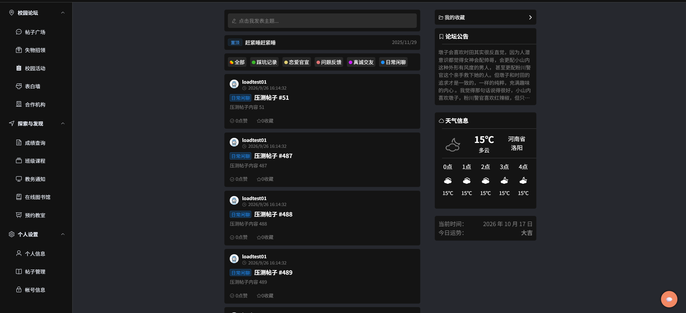
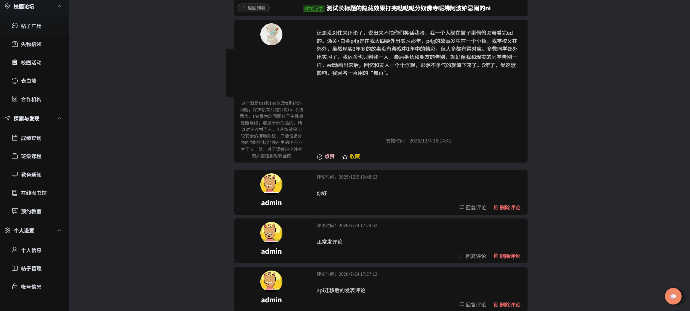
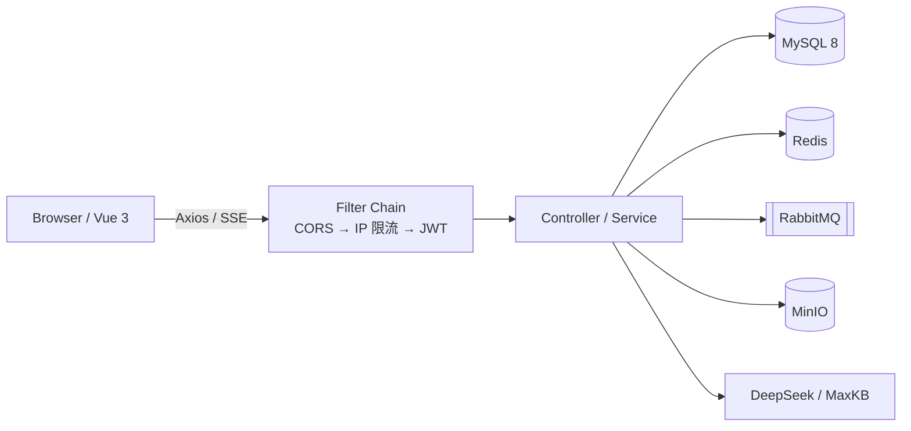
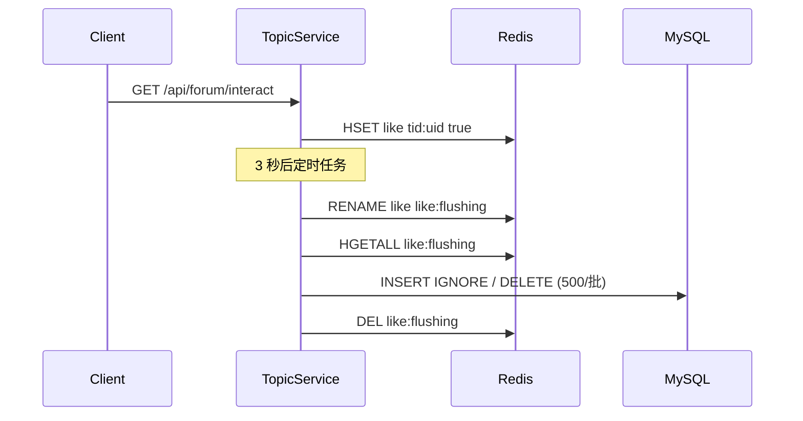

# 校园论坛 · Campus Forum

> 一个基于 Spring Boot 3 + Vue 3 的前后端分离校园社区：<br>
> 从注册登录、发帖评论，到点赞收藏、通知与管理后台，形成完整业务闭环；<br>
> 并完成了一轮从 **1,050.7 → 6,490.2 TPS**、P99 **121 ms → 10 ms** 的点赞接口压测与优化。


**单机稳态 TPS 1,050.7 → 6,490.2（6.18×） · P99 121 ms → 10 ms · 错误率 0%**

<p align="center">
  
  
</p>
<p align="center"><sub>论坛首页 / 帖子详情</sub></p>

## 项目简介

校园论坛是一个面向校园场景的社区项目：用户可以注册登录、发帖、评论、点赞、收藏，收到评论/回复通知；管理员可以管理用户、帖子与邮件记录。项目还接入了和风天气、MinIO 图片存储和基于 Spring AI + DeepSeek 的流式 AI 助手。

除了业务功能，这个仓库保留了一轮完整的性能压测过程：从修正 JMeter 测量方法开始，用对照实验逐个排除「线程数不足」「CPU 不足」「Redis 容量」等假设，最后定位并拆掉了 IP 限流、互动写入、批量落库和 Redis 连接四个串行点。压测的原始 JTL 不提交 Git（约 434 MB），但 JMX、数据、分析脚本、摘要都在 [`jmeter/`](jmeter/) 里，核心数字可以复算。

## 功能一览

| 模块 | 已实现能力 |
|---|---|
| 账号与鉴权 | 邮箱验证码注册、登录、找回/修改密码、JWT 无状态鉴权、登出黑名单、封禁/禁言 |
| 论坛内容 | 帖子列表/分类筛选/置顶、详情、发帖/编辑/删除、富文本+图片、评论/引用回复、违禁词校验 |
| 互动 | 点赞/收藏、计数展示、收藏列表、评论/回复通知 |
| 个人中心 | 头像/资料、隐私字段、我的帖子 |
| 管理后台 | 用户搜索/封禁/禁言/改密、帖子搜索/置顶/锁定/屏蔽/删除、邮件记录/重发 |
| 扩展 | 和风天气、Spring AI + DeepSeek 流式 AI 助手、Swagger |
| 工程化 | 统一 JSON 响应/异常、CORS、雪花 ID 请求追踪、多环境配置、日志 |

## 技术栈

| 层 | 技术 |
|---|---|
| 后端 | Java 17 / Spring Boot 3.5.8 / Spring Security / java-jwt 4.3.0 / MyBatis-Plus 3.5.14 / MySQL 8 / Redis (Lettuce) / RabbitMQ / Caffeine / MinIO 8.6 / Spring AI 1.1.2 / SpringDoc 2.5 |
| 前端 | Vue 3.5 / Vite 8 / Vue Router 4.6 / Pinia 3 / Axios 1.18 / Element Plus 2.11 / VueUse 14 / Quill |
| 压测 | JMeter 5.6.3 / Python 3 标准库 |

## 系统架构



## 核心设计

### 1. JWT 无状态鉴权

用 `formLogin().loginProcessingUrl("/api/auth/login")` 复用 Spring Security 自带的认证流程（`ProviderManager` + `DaoAuthenticationProvider` + `UserDetailsService` 做 BCrypt 校验），只把认证成功后的产物从 Session 换成 JWT。`JwtAuthenticationFilter` 插在 `UsernamePasswordAuthenticationFilter` 之前，解析并验签令牌 → 检查 Redis 黑名单 → 写入 `SecurityContext`，同时把 `userId` 放进 request 属性。会话策略是 `STATELESS`。

登出时把 JWT 的 `jti` 写进 Redis 黑名单，TTL 设为令牌剩余有效期；封禁/禁言用 `banned:block:<uid>`，并在 `JwtAuthenticationFilter` 里加了一层 TTL 1 秒的 Caffeine 本地缓存，把「每请求一次 Redis」降到「每用户每秒一次」。

### 2. 点赞/收藏：Redis 缓冲 + 原子 drain + 批量落库

点赞是典型的写放大场景。这里的做法是：

1. 先写 Redis Hash：`HSET like tid:uid true`，field 是 `tid:uid`；
2. 3 秒后把待落库增量合并成一批；
3. 用 `RENAME like → like:flushing` 原子搬走，再 `HGETALL`、按 500 行分批 `INSERT IGNORE` / `(tid, uid) IN` 删除；
4. 落库成功后才删除 `:flushing`；启动补偿会同时检查 `like` 和 `like:flushing`。

`RENAME` 是关键：搬运之后新写入落到一个全新的 `like` 键，物理上不可能被这一轮的删除误删，所以 Java 侧不需要 `synchronized(type.intern())`。落库本身幂等（`INSERT IGNORE` + 按 `(tid, uid)` 删除），崩溃后重放是安全的；多实例下也只有一个实例能抢到 `RENAME`。



### 3. 三层限流

| 维度 | 实现 | 默认阈值 |
|---|---|---|
| IP | `FlowLimitingFilter` + Redis Lua | 3 秒 10 次，超限封 30 秒（生产；压测时临时放宽） |
| 用户 | `FlowUtils` 计数 | 发帖 5 次/小时、评论 3 次/分钟 |
| 令牌 | 登录冷却 + 阶梯封禁 | 基础 10 秒，升级 300 秒 |

IP 维度的 Lua 脚本把「查是否已封禁 → `INCR` → 超限则 `SET` 封禁键」合成一次 Redis 原子操作：网络往返从 3 次降到 1 次，也消除了 Java 侧的全局锁。

### 4. 异步、存储与 AI

- **RabbitMQ**：邮件发送和错误处理走队列，消费失败重试 3 次后进死信队列，避免注册/找回密码被 SMTP 阻塞。
- **MinIO**：帖子图片和用户头像存对象存储，数据库只存 object name；`/images/**` 公开读取。
- **Spring AI + DeepSeek**：`/api/ai/chat` 用 `SseEmitter` 流式返回，前端边收边渲染。

### 5. 工程化

统一 `RestBean` JSON 响应和异常处理；CORS 用过滤器实现；每个请求用雪花 ID 串起日志；开发/生产双 profile；Swagger 自动生成接口文档；`logback-spring.xml` 支持按天/大小切分日志。

## 性能压测与优化

### 结果一览

| 指标 | 基线 | 优化后 | 变化 |
|---|---:|---:|---:|
| 稳态 TPS | 1,050.7 | 6,490.2 | 6.18× / +517.7% |
| 平均 RT | 46.8 ms | 6.9 ms | -85.3% |
| P95 RT | 93 ms | 9 ms | -90.3% |
| P99 RT | 121 ms | 10 ms | -91.7% |
| 错误率 | 0% | 0% | — |

> 同一台机器、同一份 `点赞压测-v2.jmx`、同一份数据集；50 线程 / 5s ramp-up / 60s，统计时剔除 20 线程 × 20s 预热和 ramp-up。<br>
> **代码路径**是 `1,050.7 → 5,305.6`（+405.0%，5.05×）；`6,490.2` 还叠加了 Lettuce 连接池与恢复完整 C2 JIT，不能全部算成代码收益。

### 测试环境与方法

| 项 | 值 |
|---|---|
| 机器 | i7-12700H，14 核 / 20 逻辑核，23.7 GB RAM |
| 系统 | Windows 11 |
| JDK | Java 17.0.12 |
| MySQL | 8.0.42 |
| JMeter | 5.6.3 |
| 部署 | 后端与 JMeter 同机，loopback |
| 目标 | `GET /api/forum/interact?tid=&type=&status=` |
| 线程 | 50（5s ramp-up，持续 60s） |
| 预热 | 20 线程 × 20s，结果剔除 |
| 账号 | 50 个（`accounts.csv` 共 150 个） |
| 帖子 | 500 个（tid 1001–1500） |
| 参数 | like 60% / collect 40%；true 60% / false 40% |
| 断言 | `$.code == 200` |

两个容易被忽略的点：

- **不能只看 HTTP 200**：项目鉴权失败返回的是 HTTP 200 + JSON body 里的 401/403，JMeter 默认会当成成功；必须挂 JSON 断言 `$.code == 200`，否则会得到一份 100% 成功的假报告。
- **IP 限流阈值要放宽**：压测时所有请求来自 `127.0.0.1`，按默认 3 秒 10 次会很快 429。把 `spring.web.flow.limit` 调到 `10000000` 只是避免 429，**过滤器仍对每个请求计数**，锁和 Redis 往返的开销仍在；双 IP 实验测的是锁，不是限流命中。

测量方法也先修过一轮：JMeter GUI 的监听器在采样线程里同步通知、监听器累积、没有预热，同一配置两次能差 30%；改用 `jmeter -n` 新进程 + 预热线程组 + 只看稳态后，三次差异降到 ±1%。

### 优化路径

| 阶段 | 关键改动 | TPS | 平均 RT | P99 | 相对上一阶段 | JTL |
|---|---|---:|---:|---:|---:|---|
| 基线 | 修复测量方法后的基线 | 1,050.7 | 46.8 ms | 121 ms | — | `logfix-mixed-50t-r1.jtl` |
| ① | IP 限流 Lua 原子化 + 封禁状态 Caffeine 缓存 | 3,307.2 | 14.8 ms | 57 ms | +214.8% | `opt-50t-r1.jtl` |
| ② | `RENAME` 原子 drain 替代 `synchronized(type.intern())` | 4,852.3 | 9.6 ms | 16 ms | +46.7% | `opt2-50t-r1.jtl` |
| ③ | 批量落库 SQL 改 `(tid, uid) IN` + 500 行分批 | 5,305.6 | 8.7 ms | 16 ms | +9.3% | `opt3-50t-r1.jtl` |
| ④ | Lettuce 连接池 + 恢复完整 C2 JIT | 6,490.2 | 6.9 ms | 10 ms | +22.3% | `opt4-50t-r1.jtl` |

<details>
<summary>完整分位数（P50 / P90 / P95 / P99 / Max）</summary>

| 阶段 | 稳态样本 | P50 | P90 | P95 | P99 | Max |
|---|---:|---:|---:|---:|---:|---:|
| 基线 | 58,837 | 45 ms | 84 ms | 93 ms | 121 ms | 233 ms |
| ① Lua 限流 + Caffeine | 185,206 | 3 ms | 40 ms | 46 ms | 57 ms | 379 ms |
| ② RENAME | 271,727 | 9 ms | 12 ms | 13 ms | 16 ms | 135 ms |
| ③ 批量 SQL | 297,115 | 9 ms | 12 ms | 13 ms | 16 ms | 140 ms |
| ④ 连接池 + C2 | 369,944 | 7 ms | 8 ms | 9 ms | 10 ms | 122 ms |

</details>

### 瓶颈是怎么一步步定位的

1. **先让尺子可信**：GUI 监听器累积 + 无预热，同配置两次差 30%；改 CLI + 预热 + 稳态，差异降到 ±1%。这一步不做，后面的对比都没有意义。
2. **确认瓶颈在服务端**：基线 1,050.7 TPS、平均 46.8 ms、稳态并发 49.2/50（Little's Law）；50→100 线程 TPS 基本不变而 RT 接近翻倍；压测期间 CPU 平均约 25%；两个 JMeter 实例可以叠加吞吐。排除「压测端没打满」和「CPU 不足」。
3. **第一处串行点：IP 限流锁**。原实现 `synchronized(address.intern())` 包住「查封禁 + 取计数 + 自增」3 次 Redis 往返，锁的粒度是 IP。双源 IP 实验：单 IP 1,050.7 → 双 IP 1,710.9 TPS（+62.8%）；而单实例 50→100 线程没有增益，排除了「线程数翻倍」的解释。第一次实验只改了目标地址，Windows 仍用 `127.0.0.1` 当源地址，无效；第二次用 `HTTPSampler.ipSource` 显式绑定源地址，并用 Redis 键 `flow:counter:127.0.0.2` 验证源 IP 真的变了。
4. **第二处串行点：`synchronized(type.intern())`**。`jstack` 30 份快照、2,483 个 HTTP 线程样本，63.2% 处于 BLOCKED，栈顶是 `TopicServiceImpl.interact`；JTL 的每秒最大 RT 在 lag=3 上也有正自相关（基线 0.25、限流优化后 0.43），与 3 秒一次的落库周期吻合。修法：`RENAME` 把增量原子搬走，新写入落到新 key，落库不再需要 Java 锁；BLOCKED 降到 0%，TPS 4,852.3。
   - 补一个教训：早先用「只压点赞」的数据集「排除」过这把锁，结论是错的——当时它被外层 IP 限流锁盖住了，**排除了外层瓶颈才看得到内层**。
5. **第三处：批量删除 SQL 退化**。`where (tid=.. and uid=..) or ...` 上千个 OR，条件内存超过 MySQL 的 `range_optimizer_max_mem_size`（默认 8MB）后，优化器放弃索引范围优化，退化成逐条件全表扫描。同一张 3.3 万行表、18,000 个条件：OR 链 91,000 ms，`(tid, uid) IN` 418 ms（218×）；2,900 个条件时还是 0 秒，18,000 个条件直接 91 秒，是断崖式退化。修法：tuple IN + 500 行分批，TPS 5,305.6。
6. **第四处：Redis 单连接**。44.1% 的线程栈里有 `io.lettuce.core.protocol.AsyncCommand.await`，`CLIENT LIST` 显示后端只有 1 条连接；加 Lettuce 连接池后 1 → 9 条，100 线程不再比 50 线程更慢。叠加恢复完整 C2 JIT 后到 6,490.2。
7. **回头校验数据**：预期 50 账号 × 500 帖 = 25,000 行，实测只有 501 行；查表发现 `PRIMARY KEY (tid)` + `UNIQUE KEY (tid, uid)` 语义矛盾，`INSERT IGNORE` 把第二个用户的点赞静默丢弃。修法：复合主键 `(tid, uid)`，Java 不用改一行。
8. **优化后暴露的启动问题**：TPS 涨上去后，原本无害的低效批量 SQL 把启动补偿阻塞在 `@PostConstruct`，Tomcat 起不来；日志中补偿开始到 Tomcat 启动约 158–176s。修法：移到 `ApplicationReadyEvent`，并保留 SQL 重写。

### 补充实验

| 实验 | 对比 | 结果 | 结论 |
|---|---|---|---|
| 线程数 | 50 → 100 | 6,490.2 → 6,288.3 TPS（-3.1%）；平均 6.9 → 14.6 ms（+111.6%）；P99 10 → 21 ms | 吞吐不再增长、RT 翻倍，已过拐点 |
| 源 IP | 1 → 2 | 1,050.7 → 1,710.9 TPS（+62.8%） | 锁按 IP 分；单实例 50→100 线程无增益，排除线程数解释 |
| 压测端余量 | 2 × JMeter | 两个实例各约 855 TPS，合计 1,710.9 | 压测端本身有余量，瓶颈在服务端 |

### 压测与校验中发现并修复的问题

压测和结果校验过程中一共定位并修复了 7 个问题：5 个功能/数据缺陷 + 2 个性能问题。

| # | 缺陷 | 发现方式 | 根因 | 修复 |
|---|---|---|---|---|
| 1 | 互动表主键只有 `tid` | 压测后校验：预期 25,000 行，实测 501 行 | `PRIMARY KEY(tid)` + `INSERT IGNORE` 静默丢弃 | `PRIMARY KEY(tid, uid)` |
| 2 | 登录限流恒拒 | 压测登录阶段同一账号 10s 内无法二次登录 | lambda 无条件 `return false` | `return !overclock` |
| 3 | 列表缓存永不失效 | 删帖/屏蔽后列表仍显示，发帖限流被重置 | 失效时删错 key 前缀 | 统一删 `topic:preview:*` |
| 4 | 帖子详情 500 | 压测账号缺少 details/privacy 行时 NPE | 未对 `accountDetails`/`accountPrivacy` 兜底 | 空对象/空数组兜底 |
| 5 | IP 限流完全失效 | 尝试触发 429 时所有请求都不限流 | 条件写成只对 `OPTIONS` 生效 | 方法白名单 + `!tryCount` |
| 6 | 启动阻塞约 160s | 日志显示补偿先于 Tomcat 启动 | `@PostConstruct` 同步补偿 + 慢 SQL | 移到 `ApplicationReadyEvent` |
| 7 | 批量删除 91s | 落库毛刺 / `EXPLAIN` | 上千 OR 条件超 8MB，退化全表扫描 | `(tid,uid) IN` + 500 行分批 |

<details>
<summary>两段关键对比：主键与批量删除 SQL</summary>

```sql
-- before：一个帖子在整个表里只能有一行
PRIMARY KEY (tid), UNIQUE KEY (tid, uid)

-- after：与业务语义一致
PRIMARY KEY (tid, uid)
```

```sql
-- before：上千个 OR，超过 range_optimizer_max_mem_size 后退化
delete from db_topic_interact_like where
  (tid = 1 and uid = 2) or (tid = 3 and uid = 4) or ...;

-- after：tuple IN，执行计划 type=range, key=PRIMARY
delete from db_topic_interact_like
where (tid, uid) in ((1,2), (3,4), ...);
```

</details>

### 边界与局限

- **代码收益和环境收益要分开**：纯代码是 `1,050.7 → 5,305.6`（+405.0%，5.05×）；`6,490.2` 含连接池和恢复 C2，C2 是修正测量环境，不算代码收益。
- **单机结果**：同机 loopback、20 逻辑核、单实例；换 8 核或分机部署，净效应需要实测。6,490 已接近单机上限，100 线程反而下降，继续提升应该横向扩展。
- **封禁是 1 秒内生效**：Caffeine TTL 1s，不是即刻；对比令牌本身 72 小时过期，用户无感。多实例要立即生效，需要在封禁入口主动失效本地缓存，并用 Redis 发布订阅广播。
- **3 秒延迟落库有一个很小的读窗口**：`RENAME` 之后、`INSERT` 提交之前，`like` 键已空、DB 里也还没有这行，`hasInteract` 可能短暂读到「未点赞」；窗口大约几十毫秒、每 3 秒一次。`time` 记录的是落库时刻，不是点击时刻。
- **固定窗口限流**在窗口边界可能放过接近 2 倍流量；对校园论坛这个场景是明确的取舍，要更精确可以换滑动窗口或令牌桶。
- **极大批次仍用 `HGETALL`**：落库时一次把 `:flushing` 全量读回，4.6 万 field 级别会占住 Redis 单线程；后续可以改 `HSCAN` 分批。
- **dev 配置含本地默认口令/JWT key**：生产部署要通过环境变量或配置中心覆盖，不要直接使用 `application-dev.yml` 里的默认值。

### 复现方式

```bash
# 1. 生成/更新摘要
python jmeter/summarize_results.py

# 2. 复算单轮
python jmeter/analyze_jtl.py jmeter/result/opt4-50t-r1.jtl

# 3. 重新跑一轮（需要后端、MySQL、Redis、RabbitMQ、MinIO 就绪）
jmeter -n -t jmeter/点赞压测-v2.jmx -l jmeter/result/run.jtl \
  -JTHREADS=50 -JRAMP=5 -JDURATION=60 \
  -JTID_MIN=1001 -JTID_MAX=1500
```

- 压测计划与复现说明：[`jmeter/README.md`](jmeter/README.md)
- 统计摘要：[`jmeter/result/SUMMARY.md`](jmeter/result/SUMMARY.md)
- JMX：[`jmeter/点赞压测-v2.jmx`](jmeter/点赞压测-v2.jmx)
- 分析脚本：[`jmeter/analyze_jtl.py`](jmeter/analyze_jtl.py)、[`jmeter/summarize_results.py`](jmeter/summarize_results.py)

> 原始 JTL 约 434 MB，未提交 Git；TPS/RT/P99 可由分析脚本复算。jstack、`CLIENT LIST`、SQL 91s/418ms、启动耗时属于当次手工诊断，不在 JTL 中。

## 快速开始

### 环境要求

- JDK 17、Maven 3.9+
- MySQL 8、Redis 6+、RabbitMQ 3.x、MinIO
- Node.js 20.19+ 或 22.12+

### 1. 初始化数据库

```bash
mysql -uroot -p < docs/schema.sql
```

`docs/schema.sql` 只包含 11 张表结构（含 `db_topic_type` 基础字典），不含用户/帖子数据。导入到空库即可；脚本不会 DROP 已有表。

### 2. 配置环境变量

```bash
cp .env.example .env
```

在仓库根目录的 `.env` 里填 SMTP、和风天气、AI 的 key。`.env` 已被忽略，不要提交。

### 3. 启动依赖服务

| 服务 | 默认地址 | 说明 |
|---|---|---|
| MySQL | `localhost:3306` | 库名 `school_froum` |
| Redis | `localhost:6379` | 开发配置默认 6379 |
| RabbitMQ | `localhost:5672` / `15672` | 邮件/错误队列 |
| MinIO | `localhost:9000` / `9001` | 需要创建 bucket `study` |

### 4. 启动后端

```bash
# 在仓库根目录执行，保证 .env 能被 dotenv 读到
mvn -f my-project-backend/pom.xml spring-boot:run
```

### 5. 启动前端

```bash
cd my-project-frontend
npm install
npm run dev
```

### 6. 访问

- 前端：`http://localhost:5173`
- 后端：`http://localhost:8080`
- Swagger：`http://localhost:8080/swagger-ui/index.html`

管理端需要 `admin` 角色。注册后执行：

```sql
UPDATE db_account SET role = 'admin' WHERE username = '你的用户名';
```

### 7. 可选：压测造数

先保证 `db_account` 里有 `id = 1` 的账号（`loadtest_data.sql` 会复制它的 BCrypt 密码），再执行：

```bash
mysql --default-character-set=utf8mb4 -uroot -p123456 school_froum \
  < jmeter/sql/loadtest_data.sql
```

## 项目结构

```text
.
├── my-project-backend
│   └── src/main/java/com/example
│       ├── config        # Security / MinIO / RabbitMQ / Swagger
│       ├── controller    # 前台、管理端、AI、图片
│       ├── filter        # CORS、IP 限流、JWT、请求日志
│       ├── service       # 业务接口与实现
│       ├── mapper        # MyBatis-Plus Mapper
│       └── utils         # JWT、限流、缓存、雪花 ID
├── my-project-frontend
│   └── src
│       ├── views         # 登录/注册/论坛/设置/管理后台
│       ├── components    # 帖子卡片、编辑器、评论、AI 窗口
│       ├── net           # Axios 封装与 API
│       ├── store         # Pinia
│       └── router        # 路由与角色守卫
├── docs
│   ├── schema.sql        # 表结构 + 分类字典
│   └── screenshots       # README 截图
└── jmeter
    ├── 点赞压测-v2.jmx
    ├── analyze_jtl.py
    ├── summarize_results.py
    ├── data
    ├── sql
    └── result/SUMMARY.md
```

## 核心接口

| 方法 | 路径 | 说明 |
|---|---|---|
| POST | `/api/auth/login` | 登录，返回 JWT |
| GET | `/api/forum/list-topic?page=&type=` | 帖子列表 |
| GET | `/api/forum/topic?tid=` | 帖子详情 |
| GET | `/api/forum/interact?tid=&type=&status=` | 点赞/收藏（压测目标） |
| POST | `/api/forum/create-topic` | 发帖 |
| POST | `/api/ai/chat` | AI 流式对话 |
| GET | `/api/admin/list` | 管理端用户列表 |

## 核心代码导航

| 关注点 | 文件 |
|---|---|
| JWT 鉴权 | [`SecurityConfiguration.java`](my-project-backend/src/main/java/com/example/config/SecurityConfiguration.java)、[`JwtAuthenticationFilter.java`](my-project-backend/src/main/java/com/example/filter/JwtAuthenticationFilter.java)、[`JwtUtils.java`](my-project-backend/src/main/java/com/example/utils/JwtUtils.java) |
| 互动写入 | [`TopicServiceImpl.java`](my-project-backend/src/main/java/com/example/service/impl/TopicServiceImpl.java)、[`TopicMapper.java`](my-project-backend/src/main/java/com/example/mapper/TopicMapper.java) |
| 限流 | [`FlowLimitingFilter.java`](my-project-backend/src/main/java/com/example/filter/FlowLimitingFilter.java)、[`FlowUtils.java`](my-project-backend/src/main/java/com/example/utils/FlowUtils.java) |
| 压测 | [`点赞压测-v2.jmx`](jmeter/点赞压测-v2.jmx)、[`analyze_jtl.py`](jmeter/analyze_jtl.py)、[`summarize_results.py`](jmeter/summarize_results.py) |

## 已知限制与后续计划

- 依赖服务目前要手动启动，后续补 `docker-compose.yml` 一键起 MySQL/Redis/RabbitMQ/MinIO。
- IP 限流是固定窗口，后续可换滑动窗口或令牌桶。
- `hasInteract` 目前只查 `like`/`collect`，可以同时检查 `:flushing` 来消除 3 秒读窗口。
- 极大批次落库用 `HGETALL`，后续可改 `HSCAN` 分批。
- 前端 API 地址在 `src/main.js` 里硬编码为 `http://localhost:8080`，部署时需要改成实际后端地址。
- 目前没有 CI 和集成测试，后续补 GitHub Actions。

## 说明

项目起步于 `SpringBoot-Vue-Template-Jwt` 模板；论坛业务、管理后台、互动写入与性能优化为个人实现。仓库未附带开源许可证，如需复用请先联系。
